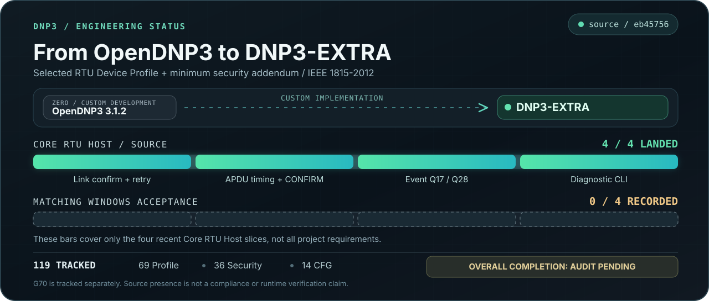

# DNP3-EXTRA

OpenDNP3 3.1.2 extensions with native Master and Outstation APIs, TCP/UDP/serial channels, Secure Authentication components and a Windows TCP/mutual-TLS diagnostic CLI.

## Scope

The RTU Device Profile selects a Level 3 Outstation with explicit extensions. The project tracks 119 requirements across 69 Profile, 36 Security and 14 runtime configuration IDs. IEEE 1815-2012 governs the selected protocol behavior. Master obligations follow the selected functions and explicit project requirements. [Historical scope and acceptance criteria](https://github.com/TheLouisMahdi/DNP3-EXTRA/blob/b94961d4ebd14196be7911d6fc132b6e6c9cc251/DNP3_PDD_PLAN/PDF_SCOPE.md)

The native paths cover measurements and events, controls, time synchronization, SA Challenge/Reply and Aggressive Mode, remote Update Key Methods 4/68, G121/G122 and mutual TLS diagnostics. The Windows CLI uses simulated I/O. Group 70 is a separately tracked extension. It includes V2–V8 codecs and opt-in authorized Outstation file metadata lookup. File transfer and the corresponding Master API remain open.

## Implementation progress



### Historical coverage percentages

| Requirement set | Tracked IDs | Prior verified | Some code evidence (including partial) |
|---|---:|---:|---:|
| Device Profile | 69 | 17.4% | 97.1% |
| Security Addendum | 36 | 38.9% | 75.0% |
| Runtime Configuration | 14 | 0.0% | 92.9% |
| All tracked IDs | 119 | 21.8% | 89.9% |

| Requirement set | Prior verified | Code present, not verified | Partial | Blocked | Missing | Not audited |
|---|---:|---:|---:|---:|---:|---:|
| Device Profile | 12 (17.4%) | 46 (66.7%) | 9 (13.0%) | 1 (1.4%) | 1 (1.4%) | 0 (0.0%) |
| Security Addendum | 14 (38.9%) | 2 (5.6%) | 11 (30.6%) | 1 (2.8%) | 3 (8.3%) | 5 (13.9%) |
| Runtime Configuration | 0 (0.0%) | 6 (42.9%) | 7 (50.0%) | 1 (7.1%) | 0 (0.0%) | 0 (0.0%) |
| All tracked IDs | 26 (21.8%) | 54 (45.4%) | 27 (22.7%) | 3 (2.5%) | 4 (3.4%) | 5 (4.2%) |

Percentages are calculated within each requirement set from [the per-ID coverage CSV](DNP3_PDF_COVERAGE.csv). "Some code evidence" is the sum of historically verified, code-present and partial statuses; it is **not** a completion, test-pass or compliance percentage. The categories are mutually exclusive, but the two summary percentages are not additive. Individual tiles carry categorical assessments, not measurable per-ID completion percentages. All statuses are **mixed-revision historical assessments**, and current `develop` acceptance remains unverified at the consolidated 119-ID level.

The progress baseline is **all selected requirements from both supplied PDFs**, not a count of recent commits: **69 Device Profile object/function rows** (including the selected group, variation, function and qualifier sets), **36 security addendum parameters**, and **14 Device Profile runtime configuration groups**. Each of the 119 tracked IDs has an individual status tile.

[Full per-ID object, function, qualifier and parameter inventory](DNP3_PDF_COVERAGE.md) | [Machine-readable coverage](DNP3_PDF_COVERAGE.csv) | [Execution ledger](EXECUTION_PHASE_STATUS.md)

**Evidence warning:** colors represent *recorded source-review assessments from different revisions*, not verified completion on current `develop`. Profile and Security are based on [pinned historical matrices](https://github.com/TheLouisMahdi/DNP3-EXTRA/tree/b94961d4ebd14196be7911d6fc132b6e6c9cc251/DNP3_PDD_PLAN); CFG entries use the [Core RTU Host source review](https://github.com/TheLouisMahdi/DNP3-EXTRA/commit/eb45756fb9b7f4e265091280067c8f9285fb1477). Current full acceptance remains pending a consolidated requirement/subcase audit and matching Windows/target evidence. G70 file transfer is a separate requested expansion outside the 119-ID scope.

## Build and test
Use installed compatible CMake, MSVC, Python 3 and OpenSSL 3 dependencies. Reuse the existing toolchain/cache configuration when available. CMake fetches pinned ASIO/executor/serialization dependencies. Commands below build the native library and diagnostic tests from the repository root.

```powershell
cmake -S opendnp3 -B build/native -DDNP3_DIAGNOSTIC_CLI=ON -DDNP3_SA_CRYPTO=ON -DDNP3_TLS=ON -DDNP3_TESTS=ON
cmake --build build/native --config Release --target dnp3-cli unittests integrationtests asiotests --parallel 4
ctest --test-dir build/native -C Release --output-on-failure
# Focused typed FC6 tests
& ./build/native/cpp/tests/unit/Release/unittests.exe '[fc6-master]'
```

The workspace CMakeLists.txt additionally defines the `master` and `outstation` demos under `apps/`. Object generation uses the existing Maven/Scala project under `opendnp3/generation/`. [Detailed Windows build, provisioning and tests](cli/README.md)

## Run
Launch the following in separate PowerShell terminals.

```powershell
& ./build/native/cli/Release/dnp3-cli.exe outstation
& ./build/native/cli/Release/dnp3-cli.exe master
```

These diagnostic defaults use explicit unprotected Compatibility mode on localhost port 20000. For SA test provisioning, role tests and TLS on port 19999, follow the CLI guide. Production credentials and RTU deployment require the selected security controls. [CLI operations](cli/README.md)

## Requirements and evidence

- [F0 source-fixed constraints and open product decisions](F0_PRODUCT_DECISIONS.md) separates authoritative PDF/IEEE values from unresolved approvals; it does not claim implemented or tested compliance.

- [Current execution ledger](EXECUTION_PHASE_STATUS.md) records code changes, outstanding decisions and deferred verification. [Windows acceptance case index](WINDOWS_TEST_TITLES.md) lists planned coverage.
- [Historical profile matrix](https://github.com/TheLouisMahdi/DNP3-EXTRA/blob/b94961d4ebd14196be7911d6fc132b6e6c9cc251/DNP3_PDD_PLAN/PROFILE_MATRIX.csv) and [historical security matrix](https://github.com/TheLouisMahdi/DNP3-EXTRA/blob/b94961d4ebd14196be7911d6fc132b6e6c9cc251/DNP3_PDD_PLAN/SECURITY_MATRIX.csv) preserve requirement IDs and prior assessments.
- [Historical engineering evidence](https://github.com/TheLouisMahdi/DNP3-EXTRA/blob/b94961d4ebd14196be7911d6fc132b6e6c9cc251/DNP3_PDD_PLAN/ENGINEERING_EVIDENCE.md) records results for specific revisions, including the November 7, 2026 Windows Host tests for selected authenticated FC6 scenarios. These results apply to their recorded test scope and revision.
- [Historical open issues](https://github.com/TheLouisMahdi/DNP3-EXTRA/blob/b94961d4ebd14196be7911d6fc132b6e6c9cc251/DNP3_PDD_PLAN/OPEN_ISSUES.md) and the [repository map](REPO_MAP.md) give background and source locations.

Open gates include G120V8 certificate trust and runtime handling, truthful G0V209 advertisement, security policy decisions, TLS revocation lifecycle and authenticated FC6 independent-peer verification. STM32H743/FreeRTOS integration and physical acceptance are tracked separately.
