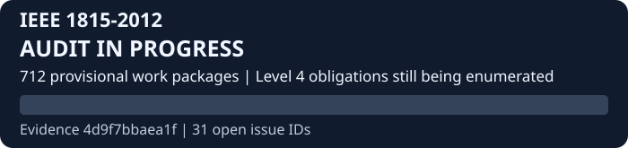
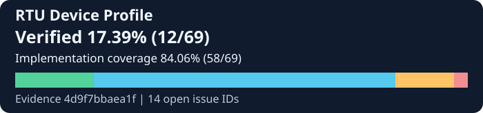
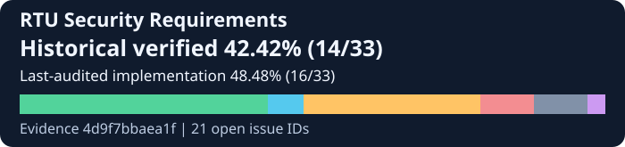

# DNP3-EXTRA

DNP3 Master and Outstation development on OpenDNP3, with a Windows console for protocol diagnostics, Secure Authentication v5 and mutual TLS.

## Standards implementation progress

Implementation progress is not equivalent to IEEE certification or independent interoperability conformance.

<!-- progress:start -->

| Scope | Verified | Implemented, unverified | Partial | Missing | Not audited | Not applicable | Blocked |
| --- | ---: | ---: | ---: | ---: | ---: | ---: | ---: |
| IEEE 1815-2012 / Outstation | 0 | 0 | 0 | 0 | 11 | 0 | 0 |
| IEEE 1815-2012 / Master | 0 | 0 | 0 | 0 | 11 | 0 | 0 |
| RTU Device Profile / Outstation | 0 | 0 | 0 | 2 | 67 | 0 | 0 |
| RTU Device Profile / Master | 0 | 0 | 0 | 1 | 68 | 0 | 0 |
| RTU Security Requirements / Outstation | 0 | 0 | 0 | 3 | 32 | 0 | 1 |
| RTU Security Requirements / Master | 0 | 0 | 0 | 2 | 25 | 8 | 1 |

| Role and scope | Strict verified | Implementation coverage | Open issue IDs |
| --- | --- | --- | ---: |
| IEEE 1815-2012 / Outstation | AUDIT IN PROGRESS | AUDIT IN PROGRESS | 13 |
| IEEE 1815-2012 / Master | AUDIT IN PROGRESS | AUDIT IN PROGRESS | 13 |
| RTU Device Profile / Outstation | 0.00% (0/69) | 0.00% (0/69) | 14 |
| RTU Device Profile / Master | 0.00% (0/69) | 0.00% (0/69) | 14 |
| RTU Security Requirements / Outstation | 0.00% (0/33) | 0.00% (0/33) | 21 |
| RTU Security Requirements / Master (8 not applicable) | 0.00% (0/27) | 0.00% (0/27) | 21 |
| Profile G120 / Outstation | 0.00% (0/15) | 0.00% (0/15) | 5 |
| Profile G120 / Master | 0.00% (0/15) | 0.00% (0/15) | 5 |
| Security recommended rows | 2 not audited | Excluded from mandatory metrics | — |
| Security optional rows | 0 rows | Excluded from mandatory metrics | — |
| Security unresolved rows | 1 not audited | Excluded from mandatory metrics | — |

Bar order: verified (green), implemented without verification (cyan), partial (amber), missing (red), not audited (slate), blocked (violet).

Latest tracked source commit **aa15ccba701740dd76a2a43f6ff0f58847271983**. Audit revision **4d9f7bbaea1fcf305d942abe7891384df18a6199**.
Last tested revision **4d9f7bbaea1fcf305d942abe7891384df18a6199** on 2026-11-03 (Windows x64 Release).
Unit **714 cases / 59,048 assertions**. Integration **12 cases / 241 assertions**, including SA TCP. [Execution evidence](cli/README.md)
Historical SA TCP baseline **2 cases / 240 assertions** at `33d7994ae551e4f3b30b7ddfb894e59c6b9e336d`.

**Historical Windows test results.** The current source differs from the tested revision.
**Audit refresh required.** Positive and partial assessments await review on this source revision.

Outstation items awaiting audit:
- **IEEE 1815-2012** — `IEEE-APDU`, `IEEE-QUALIFIERS`, `IEEE-DATA`, `IEEE-CONTROLS`, `IEEE-CLASSES-TIME-IIN`, `IEEE-ATTRIBUTES`, `IEEE-SA`, `IEEE-STATISTICS`, `IEEE-TRANSPORT-LINK`, `IEEE-STATE-MACHINES`, `IEEE-LEVEL4-ENUMERATION`
- **RTU Device Profile** — 67 rows or work packages. See the source matrices.
- **RTU Security Requirements** — 32 rows or work packages. See the source matrices.

[Formulas, evidence scope and open decisions](DNP3_PDD_PLAN/PROGRESS.md)

<!-- progress:end -->

## Requirements coverage

The Device Profile covers the 69 object and function rows identified in a 12-page excerpt from a 78-page document. The excerpt identifies a Level 3 Outstation. The separate Level 4 and SA v5 audit follows IEEE 1815-2012. The security requirements cover three tables in a six-page amendment. [Source index](DNP3_PDD_PLAN/01_SOURCE_MAP.md)

The source matrices keep Outstation and Master assessments separate. The Outstation assessment determines the primary profile count. For security, each row assesses the named RTU obligation using Windows evidence where applicable. [Device Profile](DNP3_PDD_PLAN/02_PROFILE_MATRIX.csv) · [Security requirements](DNP3_PDD_PLAN/03_SECURITY_MATRIX.md) · [Security audit](DNP3_PDD_PLAN/SECURITY_PROGRESS.csv) · [IEEE traceability](DNP3_PDD_PLAN/IEEE_TRACEABILITY.csv)

## Windows Master and Outstation

Run `dnp3-cli.exe outstation` and `dnp3-cli.exe master` in separate terminals. The default compatibility connection uses `127.0.0.1:20000`. The guide covers the Release build, measurement scans, simulated controls, SA provisioning, TLS on port 19999 and repeatable process tests. [Build and run](cli/README.md)

The Windows environment exercises SA session keys, Challenge/Reply, Aggressive Mode, remote Update Key Methods 4 and 68, user lifecycle and G121/G122. Remote authority provisioning in the console uses test credentials. [Remote Update Keys](DNP3_PDD_PLAN/SA_REMOTE_UPDATE_KEYS_REPORT.md) · [Windows acceptance evidence](cli/README.md#windows-acceptance-evidence)

## Engineering evidence

G0V209 advertisement, runtime G120V8, independent interoperability, RTU hardening and outstanding security profile decisions remain open. [Audit notes and regeneration](DNP3_PDD_PLAN/PROGRESS.md) · [Repository map](REPO_MAP.md)
